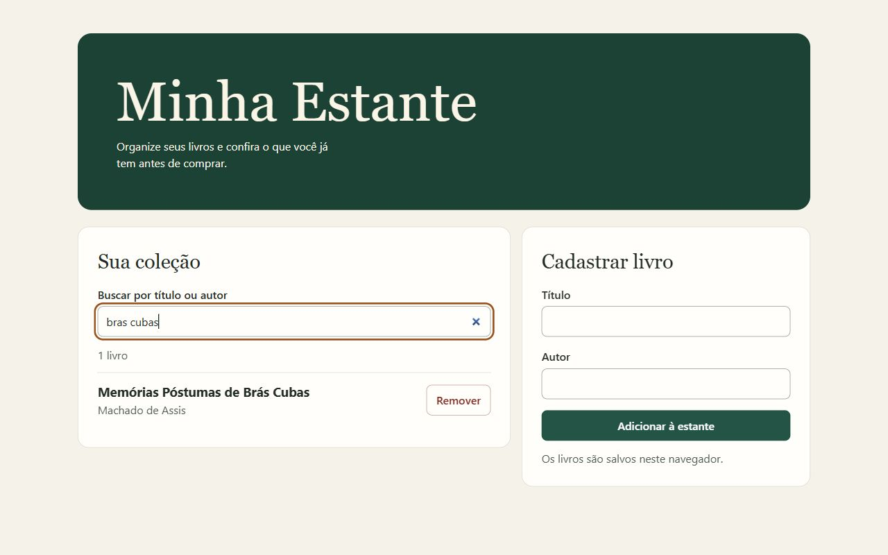
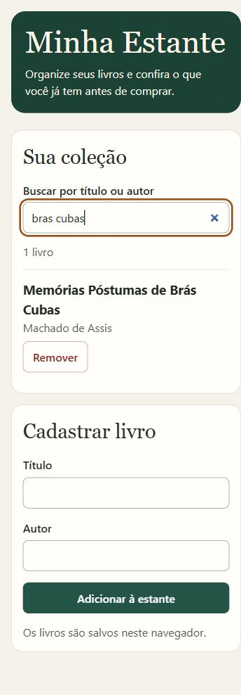

# Minha Estante

Uma biblioteca pessoal para leitores que querem conferir se já têm um livro antes de comprá-lo em um sebo, livraria ou feira.

- Cadastre livros por título e autor.
- Busque por parte do título ou do autor, com ou sem acentos.
- Remova registros com confirmação.
- Reabra a coleção no mesmo navegador, perfil e endereço.

Os dados ficam no armazenamento do navegador. Limpar os dados do site apaga a coleção. Cada dispositivo, perfil ou endereço mantém uma coleção própria. Esta versão começa com a estante vazia e não importa registros do CrudCrud. Edição, empréstimos e status de leitura ficam para versões futuras.

## Executar

Use Node.js 24 e npm. A validação foi feita com Node.js **24.14.0** e npm **11.9.0**. Abra o terminal na pasta **book-catalog**, onde estão o package.json e o package-lock.json.

```sh
npm ci
npm run dev
```

Abra a URL exibida pelo Vite. A aplicação usa o armazenamento do próprio navegador e dispensa API e variáveis de ambiente. Use localhost para desenvolvimento ou HTTPS em uma hospedagem, pois o navegador exige um contexto seguro para gerar os identificadores com crypto.randomUUID().

## Experimentar

1. Em **Cadastrar livro**, informe **Memórias Póstumas de Brás Cubas** e **Machado de Assis**.
2. Selecione **Adicionar à estante** e recarregue a página.
3. Em **Buscar por título ou autor**, digite **bras cubas** ou **machado**.
4. Limpe a busca para voltar à coleção. Para excluir um registro, selecione **Remover** e confirme.

## Tecnologias

| Tecnologia | Faixa declarada | Versão resolvida | Papel |
| --- | --- | --- | --- |
| React e React DOM | ^19.2.5 | 19.2.5 | Componentes, estado e renderização |
| TypeScript | ~6.0.2 | 6.0.3 | Tipos de dados, propriedades e eventos |
| Vite | ^8.0.9 | 8.0.9 | Servidor de desenvolvimento e build |
| Plugin React do Vite | ^6.0.1 | 6.0.1 | Integração React com o Vite |
| ESLint | ^9.39.4 | 9.39.4 | Análise estática |
| typescript-eslint | ^8.58.2 | 8.59.0 | Regras para TypeScript |

As versões resolvidas vêm do package-lock.json. CSS Modules delimita os estilos de cada área. Web Storage mantém os livros entre recargas. O executor de testes do Node roda os testes da lógica sem dependência adicional.

## Comandos

| Comando | Uso |
| --- | --- |
| npm run dev | Iniciar o servidor local |
| npm test | Rodar os testes automatizados |
| npm run test:coverage | Medir a cobertura dos módulos de catálogo e armazenamento |
| npm run lint | Analisar o código |
| npm run build | Checar tipos e gerar dist/ |
| npm run preview | Servir o build localmente |

O lint e o build passaram. Os cinco testes passaram, com 100% de linhas, funções e ramos nos dois módulos medidos. A porcentagem se refere à lógica de catálogo e armazenamento, incluindo uma simulação de recarga com armazenamento em memória.

## Decisões e validação

A versão anterior dependia de uma URL fixa do CrudCrud e limpava os campos antes de saber se o cadastro tinha sido aceito. Agora a gravação acontece antes de atualizar a lista ou limpar os campos. Uma coleção ilegível é sinalizada na tela para evitar que um novo cadastro sobrescreva os dados. O relatório explica o fluxo e as alternativas em [docs/RELATORIO-REFATORACAO.md](docs/RELATORIO-REFATORACAO.md).

No navegador, foram verificados o envio por teclado, o foco no primeiro campo inválido, o cadastro, a busca e a persistência do cadastro e da remoção após recarregar. Cancelar a remoção preservou o livro após recarregar. Ao exceder a cota do armazenamento com um cadastro de teste, a interface exibiu o erro, preservou os campos e manteve a coleção anterior. A demonstração ainda não foi publicada.

## Capturas da aplicação

Desktop (1280 px)



Celular (360 px)


